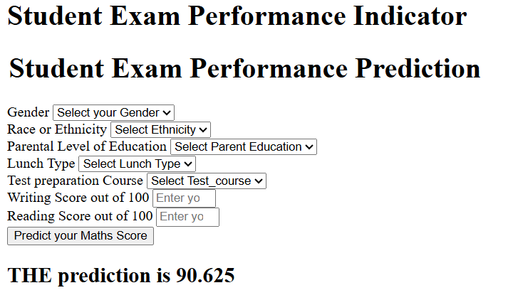

# Student Exam Performance Indicator

A machine-learning web application that predicts a student's **maths score** from demographic and educational information, along with their reading and writing scores. The application is built with Flask and deployed on Render.

> **Live demo:** https://ml-project-1-ug28.onrender.com

## Demo



The form accepts the student's gender, ethnicity group, parental education level, lunch type, test-preparation status, reading score, and writing score. After submission, the app displays a predicted maths score.

## Project objective

The goal is to explore factors associated with student exam performance and build a regression workflow that predicts `math_score` using the other available features.

## Dataset

The project uses the **Students Performance in Exams** dataset, containing 1,000 student records and 8 columns.

Source: [Students Performance in Exams — Kaggle](https://www.kaggle.com/datasets/spscientist/students-performance-in-exams)

Features used by the prediction form:

| Feature | Description |
|---|---|
| `gender` | Student gender |
| `race_ethnicity` | Student's ethnicity group (A–E) |
| `parental_level_of_education` | Parent's highest education category |
| `lunch` | Standard or free/reduced lunch category |
| `test_preparation_course` | Whether the test-preparation course was completed |
| `reading_score` | Reading exam score |
| `writing_score` | Writing exam score |

**Target:** `math_score` (score out of 100).

## Workflow

1. **Exploratory data analysis (EDA)** — inspect data types, missing values, duplicates, summary statistics, distributions, and relationships between student attributes and exam scores.
2. **Train/test split** — the project pipeline splits the data into training and test sets (80/20, with `random_state=42`).
3. **Preprocessing** — numerical reading/writing scores are imputed with the median and standardized. Categorical features are imputed with the most frequent category, one-hot encoded, and scaled.
4. **Model training and comparison** — the notebooks evaluate multiple regression algorithms using metrics such as R², MAE, and RMSE. The pipeline also uses `GridSearchCV` for parameter search.
5. **Model persistence** — the trained estimator and preprocessing transformer are saved as pickle-compatible artifacts.
6. **Web prediction** — Flask collects form inputs, builds a pandas DataFrame, loads the saved preprocessing/model artifacts, transforms the inputs, and returns the predicted maths score.
7. **Deployment** — the Flask app is served with Gunicorn on Render.

## Notebook evaluation results

The model-training notebook reports the following test-set R² scores for its model comparison experiment:

| Model | Test R² |
|---|---:|
| Ridge Regression | 0.8806 |
| Linear Regression | 0.8797 |
| Random Forest Regressor | 0.8517 |
| CatBoost Regressor | 0.8516 |
| AdaBoost Regressor | 0.8457 |
| XGBoost Regressor | 0.8278 |
| Lasso | 0.8253 |
| K-Neighbors Regressor | 0.7839 |
| Decision Tree Regressor | 0.7245 |

For the notebook's Linear Regression experiment, the recorded test metrics are **R² = 0.8797**, **MAE = 4.2279**, and **RMSE = 5.4108**.

*These figures describe the model-comparison experiment recorded in the notebook. They should not be interpreted as a separately measured evaluation of the exact model artifact currently deployed on Render.*

## Tech stack

- **Language:** Python
- **Web framework:** Flask
- **Data processing:** pandas, NumPy
- **Machine learning:** scikit-learn
- **Additional model libraries:** CatBoost, XGBoost
- **Serialization:** dill
- **Model evaluation and tuning:** scikit-learn metrics and `GridSearchCV`
- **Web server:** Gunicorn
- **Deployment:** Render
- **Analysis and visualization:** Jupyter Notebook, Matplotlib, Seaborn

## Repository structure

```text
ML_Project/
├── app.py
├── artifacts/
│   ├── data.csv
│   ├── train.csv
│   ├── test.csv
│   ├── model.pkl
│   └── preprocessor.pkl
├── notebook/
│   ├── 1 . EDA STUDENT PERFORMANCE .ipynb
│   ├── 2. MODEL TRAINING.ipynb
│   └── data/
│       └── stud.csv
├── src/
│   ├── components/
│   │   ├── data_ingestion.py
│   │   ├── data_transformation.py
│   │   └── model_trainer.py
│   ├── pipeline/
│   │   └── predict_pipeline.py
│   ├── exception.py
│   ├── logger.py
│   └── utils.py
├── templates/
│   ├── home.html
│   └── index.html
├── requirements.txt
├── setup.py
└── README.md
```

## Run locally

### 1. Clone the repository

```bash
git clone https://github.com/Ritik250/ML_project.git
cd ML_project
```

### 2. Create and activate a virtual environment

**Windows (PowerShell):**

```powershell
py -3.8 -m venv .venv
.venv\Scripts\Activate.ps1
```

**macOS/Linux:**

```bash
python3.8 -m venv .venv
source .venv/bin/activate
```

The repository pins several dependencies that were used with Python 3.8. Use a compatible Python version if a package does not provide a wheel for your environment.

### 3. Install dependencies

```bash
python -m pip install --upgrade pip
pip install -r requirements.txt
```

### 4. Start the Flask app

```bash
python app.py
```

Open the local URL printed by Flask (usually `http://127.0.0.1:5000`) and navigate to the prediction form at `/predictdata`.

## Deployment

The application is deployed on Render as a Python web service.

- **Build command:** `pip install -r requirements.txt`
- **Start command:** `gunicorn app:app`
- **Live URL:** https://ml-project-1-ug28.onrender.com

The app loads the saved `model.pkl` and `preprocessor.pkl` from the repository's `artifacts/` directory. Keep these files available at the expected paths when deploying.

## Limitations and responsible use

- Predictions are estimates learned from the supplied dataset, not guarantees of an individual student's performance.
- Dataset categories may reflect social and educational patterns; demographic features should be interpreted carefully and should not be used to make high-stakes decisions about students.
- The reported notebook scores are experimental results and may differ from the deployed artifact's performance.
- The current interface is a simple demonstration form; additional validation, monitoring, and evaluation on newer or external data would be useful before any real-world use.

## Future improvements

- Add a dedicated evaluation report for the exact deployed model artifact.
- Improve form styling, accessibility, and mobile responsiveness.
- Add input validation and user-friendly error handling.
- Add automated tests for preprocessing, prediction, and Flask routes.
- Track model versions and evaluate performance on fresh data.

## Author

**Ritik Kumar**

- GitHub: [@Ritik250](https://github.com/Ritik250)
